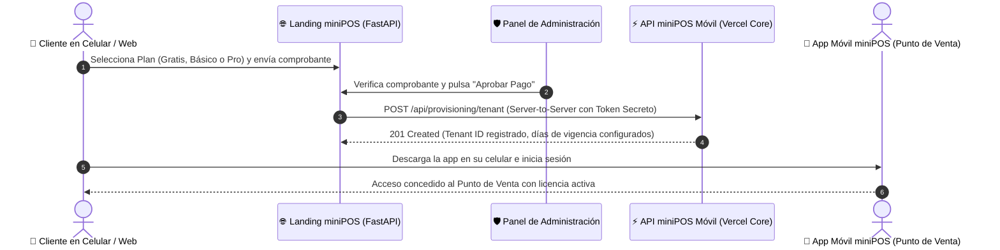

# 🚀 Guía Ejecutiva: ¿Qué hace la API de Aprovisionamiento de miniPOS?

Esta guía explica de forma clara y resumida el funcionamiento, propósito y flujo de integración de la **API Externa de Aprovisionamiento de Tenants** (`POST https://mini-pos-api.vercel.app/api/provisioning/tenant`).

---

## 1. ¿Qué es y cuál es su objetivo principal?

Es el **puente automático** que conecta la **Landing Page de Ventas (miniPOS Web)** con el **Sistema Central de la Aplicación Móvil miniPOS**.

* **Problema que resuelve:** Antes, cuando un cliente pagaba una suscripción en la web, el administrador tenía que ir manualmente a la base de datos o sistema de la app a registrar la empresa, crearle el usuario y activarle los días de licencia.
* **Solución de la API:** Ahora, en el momento exacto en que se aprueba el pago o se solicita la Prueba Gratuita, la landing page envía una petición automática y la cuenta queda **inmediatamente creada y activa en la app móvil miniPOS** para que el cliente comience a facturar sin demoras.

---

## 2. Flujo de Trabajo en 4 Pasos



---

## 3. ¿Qué datos viajan a la API?

Cuando se aprueba una suscripción, el servidor backend de la landing prepara y envía los siguientes datos en formato JSON:

```json
{
  "company_name": "Bodega La Bendición C.A.",
  "email": "contacto@bodegalabendicion.com",
  "phone": "+584121234567",
  "plan": "basic",
  "subscription_duration_days": 30
}
```

### Correspondencia de Planes:
| Plan en Landing | Clave enviada a la API | Duración por Defecto | Precio Oficial |
| :--- | :--- | :--- | :--- |
| **Prueba Gratuita** | `free_trial` | 30 días | **$0 / mes** |
| **Plan Básico** | `basic` | 30 días | **$8 / mes** |
| **Plan Pro** | `pro` | 30 días | **$10 / mes** |

---

## 4. Códigos de Respuesta del Servidor

| Código HTTP | Significado | Acción en miniPOS Landing |
| :--- | :--- | :--- |
| **`201 Created`** | Tenant aprovisionado exitosamente en la app móvil. | Se guarda el ID del tenant en la BD local y se marca acceso activado. |
| **`400 Bad Request`** | Faltan datos requeridos o formato de teléfono/correo inválido. | Se notifica al administrador en el panel para corrección. |
| **`401 Unauthorized`** | Llave secreta (`PROVISIONING_API_KEY`) inválida o expirada. | Alerta de configuración de variables de entorno `.env`. |
| **`409 Conflict`** | La empresa o teléfono ya existe registrado en la app móvil. | Se vincula la suscripción al tenant existente. |

---

## 5. Ciberseguridad y Buenas Prácticas (OWASP)

1. **Comunicación Server-to-Server:** Las peticiones a la API nunca ocurren desde el navegador del cliente ni desde JavaScript público. Se ejecutan estrictamente desde el backend en Python (`app/services/provisioning.py`).
2. **Cero Exposición de Secretos:** La clave `PROVISIONING_API_KEY` reside exclusivamente en el archivo protegido `.env` del servidor y jamás viaja al código fuente ni a la vista del cliente.
3. **Resiliencia:** Si la API externa llega a tener intermitencia o mantenimiento, la landing page registra el pago localmente y permite al administrador reintentar la sincronización con un solo clic.
