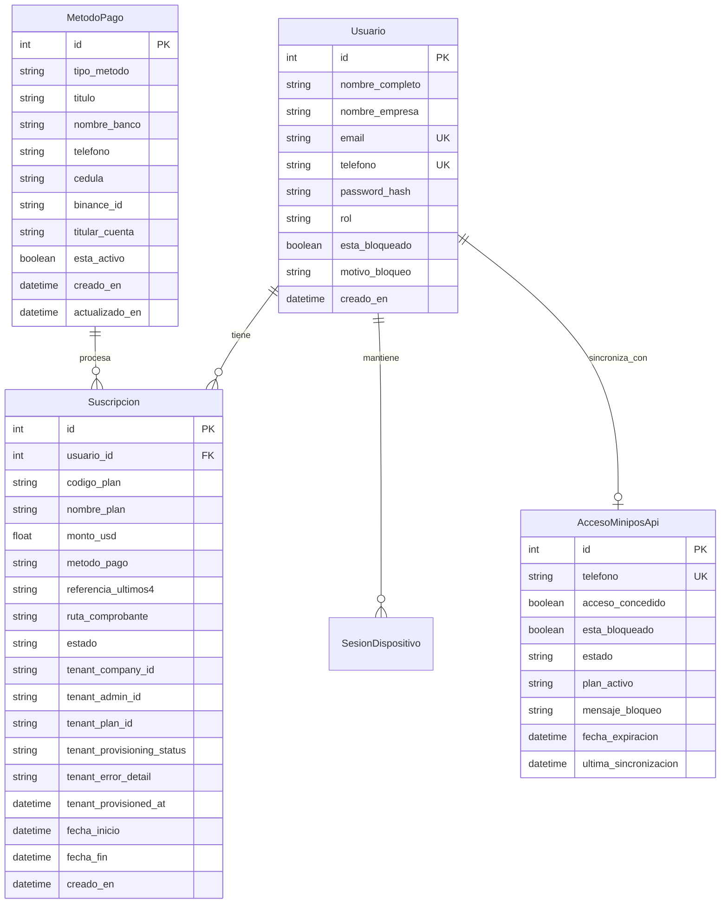

# Data Model Specification: Tenant Provisioning & PostgreSQL / Supabase Schema

**Feature**: `001-tenant-provisioning-api`
**Date**: 2026-10-15
**Status**: Ready

## Entity Relationship Overview

## Detailed Entities & Attributes

### 1. Usuario (`usuarios`)
- `id`: Integer, Clave primaria autoincremental.
- `nombre_completo`: String(150), no nulo.
- `nombre_empresa`: String(150), nullable=True. Nombre comercial del negocio/empresa.
- `email`: String(150), único, indexado, nullable=True. Correo del administrador de la cuenta.
- `telefono`: String(50), único, indexado, no nulo. Usuario para la aplicación móvil miniPOS.
- `password_hash`: String(255), no nulo. Hash de la contraseña con bcrypt/argon2.
- `rol`: String(20), por defecto `"cliente"`. (`"cliente"` o `"admin"`).
- `esta_bloqueado`: Boolean, por defecto `False`.
- `motivo_bloqueo`: String(255), por defecto `""`.
- `creado_en`: DateTime, timestamp de registro UTC.

### 2. Suscripcion (`suscripciones`)
- `id`: Integer, Clave primaria.
- `usuario_id`: Integer, Clave foránea referenciando `usuarios.id`.
- `codigo_plan`: String(50), valores permitidos: `'FREE'`, `'BASIC'`, `'PRO'`.
- `nombre_plan`: String(100), ej: `'Plan Prueba Gratis'`, `'Plan Básico'`, `'Plan Profesional'`.
- `monto_usd`: Float, valores: `0.0`, `8.0`, `10.0`.
- `metodo_pago`: String(50), ej: `'pago_movil'`, `'binance'`, `'transferencia'`, `'gratis'`.
- `referencia_ultimos4`: String(20), referencia bancaria o `'FREE-TRIAL'`.
- `ruta_comprobante`: String(255), path local o URL de imagen subida.
- `estado`: String(20), `'pendiente'`, `'aprobado'`, `'rechazado'`.
- **Campos de Aprovisionamiento Externo miniPOS**:
  - `tenant_company_id`: String(100), UUID retornado por `POST /api/provisioning/tenant`.
  - `tenant_admin_id`: String(100), UUID del usuario admin en el backend de tenants.
  - `tenant_plan_id`: String(100), UUID del plan asignado en el backend de tenants.
  - `tenant_provisioning_status`: String(50), `'pendiente'`, `'exitoso'`, `'fallido'`.
  - `tenant_error_detail`: Text, detalle de error si falló la llamada a la API externa.
  - `tenant_provisioned_at`: DateTime, timestamp de confirmación de aprovisionamiento.

### 3. MetodoPago (`metodos_pago`)
- Totalmente dinámico y gestionado exclusivamente vía Base de Datos y Panel de Administración.
- La eliminación física borra el registro de PostgreSQL de inmediato.
