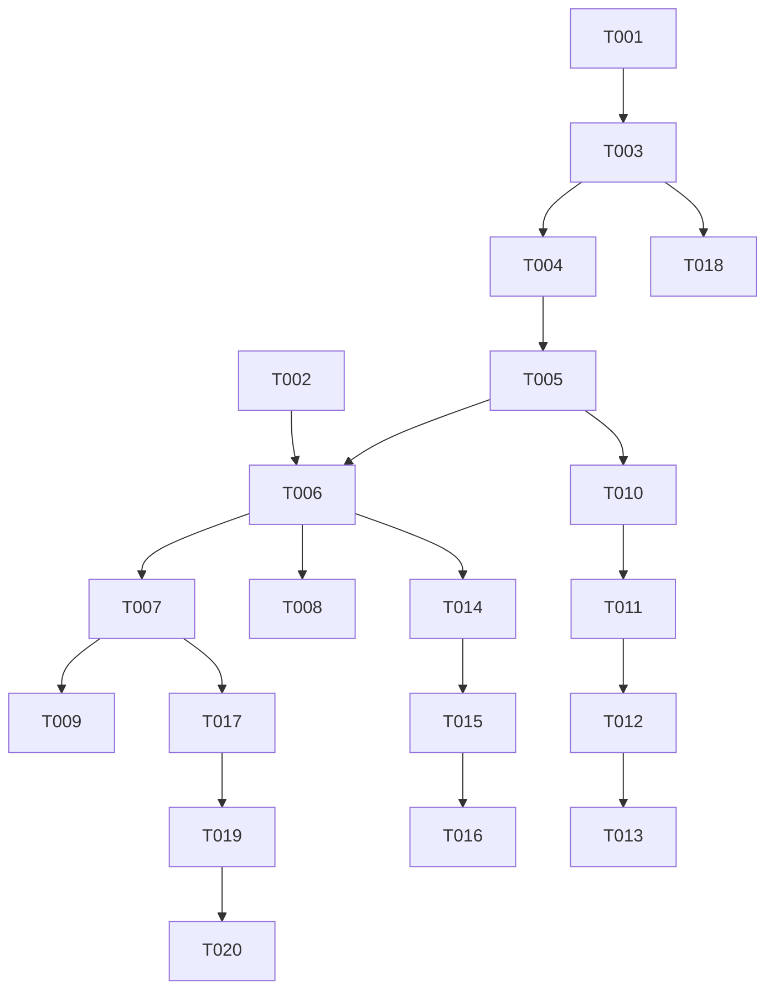

# Tasks: Tenant Provisioning API & Platform Modernization

**Feature**: `001-tenant-provisioning-api` | **Branch**: `001-tenant-provisioning-api` | **Spec**: [spec.md](spec.md) | **Plan**: [plan.md](plan.md)

## Phase 1: Setup (Shared Infrastructure)

**Purpose**: Project initialization and dependencies configuration

- [X] T001 Actualizar dependencias en `requirements.txt` agregando `httpx>=0.27.0` y `psycopg2-binary>=2.9.9`
- [X] T002 [P] Configurar variables de entorno y documentar variables en `.env.example` (`PROVISIONING_API_USER`, `PROVISIONING_API_PASSWORD`, `PROVISIONING_API_URL`, `PROVISIONING_ALLOWED_ORIGINS`, `APP_BASE_URL`, `PORT`)

---

## Phase 2: Foundational (Blocking Prerequisites)

**Purpose**: Core database and entity foundations that MUST be complete before user story execution

**⚠️ CRITICAL**: No user story work can begin until this phase is complete

- [X] T003 Adaptar motor de conexión SQLAlchemy en `app/database.py` para soportar URLs de PostgreSQL (`postgresql+psycopg2://`), compatibilidad SSL `sslmode=require` y connection pooling
- [X] T004 [P] Extender modelos en `app/models.py` agregando `nombre_empresa` y `email` en `Usuario`, y `tenant_company_id`, `tenant_admin_id`, `tenant_plan_id`, `tenant_provisioning_status`, `tenant_error_detail`, `tenant_provisioned_at` en `Suscripcion`
- [X] T005 [P] Actualizar esquemas Pydantic en `app/schemas.py` agregando validaciones para campos de empresa, email y política de contraseña (mínimo 8 caracteres, al menos una letra y un dígito)

**Checkpoint**: Base de datos, modelos y esquemas tipados listos para implementar las historias de usuario.

---

## Phase 3: User Story 1 - Aprobación y Aprovisionamiento Automático de Suscripción (Priority: P1) 🎯 MVP

**Goal**: Permitir que los clientes activen su plan (FREE de inmediato, BASIC/PRO tras aprobación) despachando automáticamente el aprovisionamiento desatendido a la API externa de miniPOS.

**Independent Test**: Invocar la activación de un plan FREE o aprobar un plan BASIC/PRO y verificar que la API externa reciba el payload, responda HTTP 201 Created y los IDs queden almacenados en la suscripción local.

### Implementation for User Story 1

- [X] T006 [US1] Implementar el cliente HTTP de aprovisionamiento en `app/services/provisioning.py` con autenticación Basic Auth, cabeceras `Authorization`, `Content-Type` y `Origin`, invocando `POST /api/provisioning/tenant`
- [X] T007 [US1] Integrar el aprovisionamiento inmediato del plan `FREE` en el endpoint `submit_payment` de `app/routers/suscripciones.py`
- [X] T008 [US1] Integrar el aprovisionamiento de tenants para planes `BASIC` y `PRO` en la acción de aprobación en `app/routers/administracion.py`
- [X] T009 [US1] Crear script de prueba de integración en `scratch/test_provisioning_client.py` para validar la invocación a la API externa de tenants

**Checkpoint**: Aprovisionamiento desatendido funcional y verificable como MVP.

---

## Phase 4: User Story 2 - Alineación de Catálogo de Planes y Formulario de Registro (Priority: P2)

**Goal**: Alinear la landing page a los 3 planes comerciales (FREE $0, BASIC $8, PRO $10) y recopilar en el checkout todos los datos requeridos por la API externa.

**Independent Test**: Verificar visualmente en desktop y mobile que la sección de planes muestre $0, $8 y $10, y que el modal de checkout pida nombre de empresa, correo y valide contraseña segura.

### Implementation for User Story 2

- [X] T010 [US2] Actualizar diccionario de planes comerciales `PLANS_INFO` en `app/routers/suscripciones.py` a `FREE` ($0.0), `BASIC` ($8.0) y `PRO` ($10.0)
- [X] T011 [US2] Actualizar sección `#planes` en `templates/index.html` con las 3 tarjetas de planes oficiales: FREE ($0), BASIC ($8/mes) y PRO ($10/mes)
- [X] T012 [US2] Actualizar el modal de checkout en `templates/index.html` añadiendo campos para Nombre de Empresa (`companyName`) y Correo Electrónico (`email`)
- [X] T013 [US2] Implementar en `static/js/main.js` la validación de contraseña en tiempo real (mínimo 8 caracteres, alfanumérica) y empaquetado de datos del nuevo checkout

**Checkpoint**: Landing page y modal de checkout alineados visualmente y a nivel de datos.

---

## Phase 5: User Story 3 - Resiliencia y Manejo de Errores en Aprovisionamiento (Priority: P3)

**Goal**: Garantizar que los fallos de red, datos duplicados (409 Conflict) o credenciales inválidas (401) se gestionen con mensajes claros al usuario sin filtrar datos sensibles.

**Independent Test**: Simular un registro con un correo ya existente y verificar que el sistema capture el código 409 y presente un aviso amigable de correo duplicado.

### Implementation for User Story 3

- [X] T014 [US3] Agregar captura estructurada de códigos HTTP 400, 401, 403 y 409 en `app/services/provisioning.py`
- [X] T015 [US3] Implementar manejo de excepciones y respuestas JSON explicativas en `app/routers/suscripciones.py`
- [X] T016 [US3] Actualizar feedback visual de errores en el formulario de checkout en `static/js/main.js`

**Checkpoint**: Manejo de errores blindado sin fuga de información interna.

---

## Phase 6: Polish & Cross-Cutting Concerns (Render & Supabase Readiness)

**Purpose**: Preparación de infraestructura de producción para Render y Supabase

- [X] T017 [P] Crear archivo de manifiesto `render.yaml` con configuración de servicio web (build y start con `$PORT` dinámico)
- [X] T018 [P] Crear script de migración y volcado de datos MySQL hacia Supabase (PostgreSQL) en `scratch/migrate_to_supabase.py`
- [X] T019 Actualizar `app/main.py` para lectura dinámica de `PORT` y orígenes CORS desde variables de entorno
- [X] T020 Ejecutar escenarios de prueba completos documentados en `specs/001-tenant-provisioning-api/quickstart.md`

---

## Dependencies & Execution Order

